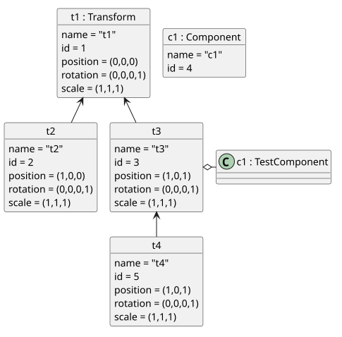

#+TITLE: Light Game Engine Quality Management Plan
#+SUBTITLE: Phase 1: Specification Based Testing
#+AUTHOR: Max Morabito

#+LATEX_HEADER: \usepackage{tabularx}
#+LATEX_HEADER: \usepackage[inkscapelatex=false]{svg}
#+LATEX_HEADER: \usepackage[margin=0.25in]{geometry}
#+LATEX_HEADER: \usepackage{caption}
#+LATEX_HEADER: \usepackage{subcaption}
#+LATEX_HEADER: \usepackage{tikz}
#+LATEX_HEADER: \usepackage{booktabs}
#+LATEX_HEADER: \definecolor{bg}{rgb}{0.95,0.95,0.95}
#+LATEX_HEADER: \usepackage{underscore}
#+LATEX_HEADER: \setminted{linenos=true, numbersep=5pt}
#+PROPERTY: header-args:plantuml :file-ext svg
#+OPTIONS: toc:nil
#+Options: num:2

#+TOC: headlines 2

\clearpage

* Project

** Light
Light is a minimalist game engine, designed to allow a modern, editor-based workflow while being lightweight enough to run on the vast majority of modern hardware.  It was written over a period of about 20 days for CSC455 at SUNY Oswego.
It is available, fully open-source and free to use, at https://github.com/vasuki1129/light.

\begin{figure}[htbp]
  \centering
  \begin{subfigure}{0.80\textwidth}
  \centering
  \includegraphics[width=0.98\textwidth]{diagrams/light_editor_ss}
  \caption{The engine in editor mode, being used to construct a scene.}
  \end{subfigure}
\end{figure}
\begin{figure}[htbp]
  \centering
  \begin{subfigure}{0.80\textwidth}
  \centering
  \includegraphics[width=0.98\textwidth]{diagrams/light_game_ss}
  \caption{The same scene in gameplay mode.}
  \end{subfigure}
\end{figure}

\clearpage

** Component Under Test
The focus of the testing will be limited to the `Transform` class due to time constraints. This class is used to build a graph structure representing a 3D scene, along with allowing pieces of C++ code (`Component`s) to be attached to nodes in this graph.  The vast majority of the other features of the engine rely on this class, so it is the most critical to test.  Additionally, it is known to have at least one flaw.

* The Transform Class
** Purpose
The Transform class forms a single node in a rooted, directed graph that represents a three-dimensional scene.  Each transform represents the location, orientation, and scale of a coordinate frame (in mathematical terms, it defines a basis with an offset). The methods being tested here are the ones that allow constructing this graph, as well as the ones that interact with the Transform's spatial properties (position, rotation, and scale).

** Object Diagram
This object diagram provides an example of what a transform graph might look like during a run of the program. Fields irrelevant to testing have been omitted.
#+BEGIN_SRC plantuml :file diagrams/scenegraph_object_diagram.svg
  @startuml
    scale 0.75
    allowmixing

    object "root : Transform" {
      name = "root"
      id = 1
      position = <U+0028>0,0,0<U+0029>
      rotation = <U+0028>0,0,0,1<U+0029>
      scale = <U+0028>1,1,1<U+0029>
    }
    
    object t2

    t2 : name = "t2"
    t2 : id = 2
    t2 : position = <U+0028>1,0,0<U+0029>
    t2 : rotation = <U+0028>0,0,0,1<U+0029>
    t2 : scale = <U+0028>1,1,1<U+0029>

    object t3

    t3 : name = "t3"
    t3 : id = 3
    t3 : position = <U+0028>1,0,1<U+0029>
    t3 : rotation = <U+0028>0,0,0,1<U+0029>
    t3 : scale = <U+0028>1,1,1<U+0029>

    object "c1 : Component"
    "c1 : Component" : name = "c1"
    "c1 : Component" :  id = 4
    
    "root : Transform" --- t2
    "root : Transform" --- t3

    t3 o-right- "c1 : Component"

    object t4 {
      name = "t4"
      id = 5
      position = <U+0028>1,0,1<U+0029>
      rotation = <U+0028>0,0,0,1<U+0029>
      scale = <U+0028>1,1,1<U+0029>
    } 

   t3 --- t4 

  @enduml
      
#+END_SRC
#+attr_latex: :width 8cm
#+results:

\newpage

** Currently Known Flaw

To illustrate the flaw, imagine a transform called "A" at the origin, with a transform "B" as its child, translated along the Y axis an arbitrary distance.  If the transform "A" is rotated about its Z axis, the child should follow the parent, such that it maintains its position and rotation relative to the parent. Instead, the child rotates independently.

\begin{figure}[htbp]
  \centering
  \begin{subfigure}{0.30\textwidth}
  \centering
  \begin{tikzpicture}
    \node[draw] at (0,0) {A};
    \node[draw] at (0,3) {B};
  \end{tikzpicture}
  \caption{Initial setup, A is the parent of B}
  \end{subfigure}
  \hfill
  \begin{subfigure}{0.30\textwidth}
  \centering
  \begin{tikzpicture}
    \node[draw,rotate=-45] at (-3,0) {A};
    \node[draw,rotate=-45] at (-0.9,2.12) {B};
  \end{tikzpicture}
  \caption{Intended result after 45 degree clockwise rotation of A}
  \end{subfigure}
  \hfill
    \begin{subfigure}{0.30\textwidth}
  \centering
  \begin{tikzpicture}
    \node[draw, rotate=-45] at (0,0) {A};
    \node[draw, rotate=-45] at (0,3) {B};
  \end{tikzpicture}
  \caption{Actual result with current code}
  \end{subfigure}
\end{figure}

* Quality Management Plan
** Quality Criteria
#+ATTR_LATEX: :environment tabularx :width \textwidth :align lXXX :hline \hline
|------------------------+----------------------------------------------------------------------+-------------------------------------------------------------------------------+-------------------------------------------------------------------|
| *Quality Property*     | *Definition*                                                         | *Metric*                                                                      | *Criterion*                                                       |
|------------------------+----------------------------------------------------------------------+-------------------------------------------------------------------------------+-------------------------------------------------------------------|
| Functional Correctness | Test cases yield the expected results anticipated during derivation. | Number of test cases that pass.                                               | 90% of test cases pass.                                           |
|------------------------+----------------------------------------------------------------------+-------------------------------------------------------------------------------+-------------------------------------------------------------------|
| Fault Tolerance        | Software should run as intended even if invalid inputs are supplied. | Number of test cases that produce an unrecoverable error, such as a segfault. | All test cases properly recover from invalid inputs.              |
|------------------------+----------------------------------------------------------------------+-------------------------------------------------------------------------------+-------------------------------------------------------------------|
| Performance            | Software should run efficiently enough to allow smooth rendering.    | Time taken to update state and render a frame.                                | Average frame time is under 16ms (60 frames per second or higher) |
|------------------------+----------------------------------------------------------------------+-------------------------------------------------------------------------------+-------------------------------------------------------------------|

** Quality Management Tools
#+ATTR_LATEX: :environment tabularx :width \textwidth :align lXXX :hline \hline
|----------+---------------------------------------------------------------------------------|
| *Tool*   | *Purpose*                                                                       |
|----------+---------------------------------------------------------------------------------|
| Doxygen  | Automatic generation of well-formatted documentation from source code comments. |
|----------+---------------------------------------------------------------------------------|
| Mermaid  | Generation of control flow graphs from text definitions.                        |
|----------+---------------------------------------------------------------------------------|
| PlantUML | Generation of UML diagrams from text definition.                                |
|----------+---------------------------------------------------------------------------------|
| Doctest  | Automated unit testing and result reporting.                                    |
|----------+---------------------------------------------------------------------------------|

** Test Plan
#+ATTR_LATEX: :environment tabularx :width \textwidth :align lXXX :hline \hline
|-----------------------------+---------------------------------------------------------------------------------------------------------------+--------------------|
| *Testing Phase*             | *Testing Activity*                                                                                            | *Test Deadline*    |
|-----------------------------+---------------------------------------------------------------------------------------------------------------+--------------------|
| Specification-Based Testing | Derivation of equivalence classes, boundary values, and test cases based on the specification of each method. | October 11th, 2026 |
|-----------------------------+---------------------------------------------------------------------------------------------------------------+--------------------|

Further phases are yet to be determined.

\clearpage

* Equivalence Class Testing

** Transform::AddChild(Transform* tr)
*** Specification
#+BEGIN_SRC c++ 
  /**
   * Add a child transform to this transform
   *
   * If the desired child is already a child of this transform
   * log a warning and ignore it
   *
   * @param tr the transform to add as a child
   *
   */
  void AddChild(Transform *tr);

#+END_SRC
*** Equivalence Classes
#+ATTR_LATEX: :environment tabularx :width \textwidth :align lXXX :hline \hline
|----------------+---------+--------------------+-------------------|
| *Eq. Class ID* | *Param* | *Description*      | *Representative*  |
|----------------+---------+--------------------+-------------------|
| 4.1.EC1.1      | tr      | a valid pointer    | new Transform()   |
|----------------+---------+--------------------+-------------------|
| 4.1.EC1.a      | tr      | a null pointer     | nullptr           |
|----------------+---------+--------------------+-------------------|
*** Test Cases
#+ATTR_LATEX: :environment tabularx :width \textwidth :align lXXX :hline \hline
|----------------+-----------------------------------+--------------------+------------|
| *Test Case ID* | *Param.*                          | *Expected*         | *Coverage* |
|                | \textit{tr}                       |                    |            |
|----------------+-----------------------------------+--------------------+------------|
| 4.1.TC1        | A pointer to some valid Transform | No output          | 4.1.EC1.1  |
|----------------+-----------------------------------+--------------------+------------|
| 4.1.TC2        | nullptr                           | Error: log message | 4.1.EC1.a  |
|----------------+-----------------------------------+--------------------+------------|

*** Test Implementation
#+BEGIN_SRC c++ :tangle ../src/test/transform_test.cpp
  #include "../doctest/doctest.h"
  #include "../engine/transform.h"
  #include "../engine/component.h"
  using namespace engine;

  TEST_CASE("4.1.TC1") {
    Transform* test_transform = new Transform();
    Transform* child_transform = new Transform();
    //redirect cout to a string so we can check for the error message
    std::stringstream buffer;
    std::streambuf* old_cout = std::cout.rdbuf(buffer.rdbuf());
    test_transform->AddChild(child_transform);
    std::cout.rdbuf(old_cout);
    CHECK(buffer.str() == ""); //no output expected
  }
  TEST_CASE("4.1.TC2") {
    Transform* test_transform = new Transform();
    std::stringstream buffer;
    std::streambuf* old_cout = std::cout.rdbuf(buffer.rdbuf());
    test_transform->AddChild(nullptr);
    std::cout.rdbuf(old_cout);
    CHECK(buffer.str() != ""); //some kind of log output expected    
  }
#+END_SRC

\clearpage

** Transform::AddComponent(Component* component)
*** Specification
#+BEGIN_SRC c++

  /**
   * Add a component to this transform
   *
   * If the supplied pointer is null, log error and ignore
   * If the supplied pointer is not a component, log error and ignore
   *
   * @param component A pointer to the component to add
   */  
  void AddComponent(Component* component);
#+END_SRC

*** Equivalence Classes
#+ATTR_LATEX: :environment tabularx :width \textwidth :align lXXX :hline \hline
|----------------+-----------+-----------------------------------------------------+---------------------|
| *Eq. Class ID* | *Param*   | *Description*                                       | *Representative*    |
|----------------+-----------+-----------------------------------------------------+---------------------|
| 4.2.EC1.1      | component | a valid pointer to a class that extends Component   | new Component()     |
|----------------+-----------+-----------------------------------------------------+---------------------|
| 4.2.EC1.a      | component | a valid pointer to something other than a Component | new Transform()     |
|----------------+-----------+-----------------------------------------------------+---------------------|
| 4.2.EC1.b      | component | an invalid pointer                                  | nullptr             |
|----------------+-----------+-----------------------------------------------------+---------------------|

*** Test Cases
#+ATTR_LATEX: :environment tabularx :width \textwidth :align lXXX :hline \hline
|----------------+---------------------+--------------------------------------------------------+--------------------|
| *Test Case ID* | *Param.*            | *Expected*                                             | *Coverage*         |
|                | \textit{tr}         |                                                        |                    |
|----------------+---------------------+--------------------------------------------------------+--------------------|
| 4.2.TC1        | new TestComponent() | No output                                              | 4.2.EC1.1          |
|----------------+---------------------+--------------------------------------------------------+--------------------|
| 4.2.TC2        | new Transform()     | Disallowed by type checking, TC implementation omitted | 4.2.EC1.a          |
|----------------+---------------------+--------------------------------------------------------+--------------------|
| 4.2.TC3        | nullptr             | Error: log message and ignore                          | 4.2.EC1.b          |
|----------------+---------------------+--------------------------------------------------------+--------------------|

*** Test Implementation
#+BEGIN_SRC c++ :tangle ../src/test/transform_test.cpp
  TEST_CASE("4.2.TC1") {
    Transform* test_transform = new Transform();
    Component* test_component = new Component();
    //redirect cout to a string so we can check for the error message
    std::stringstream buffer;
    std::streambuf* old_cout = std::cout.rdbuf(buffer.rdbuf());
    test_transform->AddComponent(test_component);
    std::cout.rdbuf(old_cout);
    CHECK(buffer.str() == ""); //no output expected
  }
  TEST_CASE("4.2.TC3") {
    Transform* test_transform = new Transform();
    Component* test_component = nullptr;
    std::stringstream buffer;
    std::streambuf* old_cout = std::cout.rdbuf(buffer.rdbuf());
    test_transform->AddComponent(test_component);
    std::cout.rdbuf(old_cout);
    CHECK(buffer.str() != ""); //some kind of log output expected
  }
#+END_SRC

\clearpage

** Transform::FindChildByName(std::string name)
*** Equivalence Classes
#+ATTR_LATEX: :environment tabularx :width \textwidth :align lXXX :hline \hline
|----------------+---------+------------------+------------------|
| *Eq. Class ID* | *Param* | *Description*    | *Representative* |
|----------------+---------+------------------+------------------|
| 4.3.EC1.1      | name    | A string         | "string"         |
|----------------+---------+------------------+------------------|
| 4.3.EC1.2      | name    | The empty string | ""               |
|----------------+---------+------------------+------------------|
| 4.3.EC1.a      | name    | Not a string     | 1                |
|----------------+---------+------------------+------------------|
*** Test Cases
#+ATTR_LATEX: :environment tabularx :width \textwidth :align lXXX :hline \hline
|----------------+---------------+----------------------------------------------------------------------------+------------|
| *Test Case ID* | *Param.*      | *Expected*                                                                 | *Coverage* |
|                | \textit{name} |                                                                            |            |
|----------------+---------------+----------------------------------------------------------------------------+------------|
| 4.3.TC1        | "string"      | nullptr                                                                    | 4.3.EC1.1  |
|----------------+---------------+----------------------------------------------------------------------------+------------|
| 4.3.TC2        | ""            | nullptr                                                                    | 4.3.EC1.2  |
|----------------+---------------+----------------------------------------------------------------------------+------------|
| 4.3.TC3        | 1             | This will be disallowed by type checking, so TC implementation is omitted. | 4.3.EC1.a  |
|----------------+---------------+----------------------------------------------------------------------------+------------|

- The specification is unclear on whether the empty string is a valid name for a Transform, so I am assuming it is a valid transform name.

*** Test Implementation
#+BEGIN_SRC c++ :tangle ../src/test/transform_test.cpp
  TEST_CASE("4.3.TC1") {
    Transform* test_transform = new Transform();
    std::stringstream buffer;
    std::streambuf* old_cout = std::cout.rdbuf(buffer.rdbuf());
    Transform* out = test_transform->FindChildByName("string");
    std::cout.rdbuf(old_cout);
    CHECK(out == nullptr);
    delete test_transform;
  }
  TEST_CASE("4.3.TC2") {
    Transform* test_transform = new Transform();
    std::stringstream buffer;
    std::streambuf* old_cout = std::cout.rdbuf(buffer.rdbuf());
    Transform* out = test_transform->FindChildByName("");
    std::cout.rdbuf(old_cout);
    CHECK(out == nullptr);
    delete test_transform;
  }
#+END_SRC

\clearpage

** Transform::FindComponentByUID(uint64_t id)

*** Equivalence Classes
#+ATTR_LATEX: :environment tabularx :width \textwidth :align lXXX :hline \hline
|----------------+---------+--------------------+------------------|
| *Eq. Class ID* | *Param* | *Description*      | *Representative* |
|----------------+---------+--------------------+------------------|
| 4.4.EC1.1      | id      | A positive integer |                1 |
|----------------+---------+--------------------+------------------|
| 4.4.EC1.2      | id      | Zero               |                0 |
|----------------+---------+--------------------+------------------|
| 4.4.EC1.a      | id      | A negative integer |               -1 |
|----------------+---------+--------------------+------------------|

*** Boundary Value Analysis
#+ATTR_LATEX: :environment tabularx :width \textwidth :align lXXX :hline \hline
|-----------+-------------------------------|
| Parameter | Boundary Values               |
|-----------+-------------------------------|
| id        | 0, UINT64\textunderscore{}MAX |
|-----------+-------------------------------|

*** Test Cases
#+ATTR_LATEX: :environment tabularx :width \textwidth :align lXXX :hline \hline
|----------------+-------------+--------------------------------------------------------+-----------|
| *Test Case ID* |    *Param.* | *Expected*                                             | Coverage  |
|                | \textit{id} |                                                        |           |
|----------------+-------------+--------------------------------------------------------+-----------|
| 4.4.TC1        |           1 | nullptr                                                | 4.4.EC1.1 |
|----------------+-------------+--------------------------------------------------------+-----------|
| 4.4.TC2        |           0 | nullptr                                                | 4.4.EC1.2 |
|----------------+-------------+--------------------------------------------------------+-----------|
| 4.4.TC3        |          -1 | Disallowed by type checking, TC implementation omitted | 4.4.EC1.a |
|----------------+-------------+--------------------------------------------------------+-----------|

*Boundary Value Test Cases*
#+ATTR_LATEX: :environment tabularx :width \textwidth :align lXXX :hline \hline
|----------------+------------------------------+--------------------------------------------------------+----------------------------|
| *Test Case ID* | *Param.*                     | *Expected*                                             | Note                       |
|                | \textit{id}                  |                                                        |                            |
|----------------+------------------------------+--------------------------------------------------------+----------------------------|
| 4.4.TC4        | 1                            | nullptr                                                | Already covered by 4.4.TC1 |
|----------------+------------------------------+--------------------------------------------------------+----------------------------|
| 4.4.TC5        | 0                            | nullptr                                                | Already covered by 4.4.TC2 |
|----------------+------------------------------+--------------------------------------------------------+----------------------------|
| 4.4.TC6        | -1                           | Disallowed by type checking, TC implementation omitted | Already covered by 4.4.TC3 |
|----------------+------------------------------+--------------------------------------------------------+----------------------------|
| 4.4.TC7        | UINT64\textunderscore{}MAX-1 | nullptr                                                |                            |
|----------------+------------------------------+--------------------------------------------------------+----------------------------|
| 4.4.TC8        | UINT64\textunderscore{}MAX   | nullptr                                                |                            |
|----------------+------------------------------+--------------------------------------------------------+----------------------------|
| 4.4.TC9        | UINT64\textunderscore{}MAX+1 | same as 4.4.TC5 due to overflow                        |                            |
|----------------+------------------------------+--------------------------------------------------------+----------------------------|

\clearpage

*** Test Implementation
#+BEGIN_SRC c++ :tangle ../src/test/transform_test.cpp
  TEST_CASE("4.4.TC1") {
    Transform* test_transform = new Transform();
    Component* out = test_transform->FindComponentByUID(1);
    CHECK(out == nullptr);
    delete test_transform;
  }
  TEST_CASE("4.4.TC7") {
    Transform* test_transform = new Transform();
    Transform* out = test_transform->FindTransformByUID(UINT64_MAX-1);
    CHECK(out == nullptr);
    delete test_transform;
  }
  TEST_CASE("4.4.TC2") {
    Transform* test_transform = new Transform();
    Component* out = test_transform->FindComponentByUID(0);
    CHECK(out == nullptr);
    delete test_transform;
  }
  TEST_CASE("4.4.TC7") {
    Transform* test_transform = new Transform();
    Component* out = test_transform->FindComponentByUID(UINT64_MAX-1);
    CHECK(out == nullptr);
    delete test_transform;
  }
  TEST_CASE("4.4.TC8") {
    Transform* test_transform = new Transform();
    Component* out = test_transform->FindComponentByUID(UINT64_MAX);
    CHECK(out == nullptr);
    delete test_transform;
  }
  TEST_CASE("4.4.TC9") {
    Transform* test_transform = new Transform();
    Component* out = test_transform->FindComponentByUID(UINT64_MAX+1);
    CHECK(out == nullptr);
    delete test_transform;
  }
#+END_SRC

\clearpage

** Transform::FindTransformByUID(uint64_t id)

*** Equivalence Classes
Equivalence classes same as Transform::FindComponentByUID.

*** Test Cases
#+ATTR_LATEX: :environment tabularx :width \textwidth :align lXXX :hline \hline
|----------------+-------------+--------------------------------------------------------+-----------|
| *Test Case ID* |    *Param.* | *Expected*                                             | Coverage  |
|                | \textit{tr} |                                                        |           |
|----------------+-------------+--------------------------------------------------------+-----------|
| 4.5.TC1.1      |           1 | nullptr                                                | 4.5.EC1.1 |
|----------------+-------------+--------------------------------------------------------+-----------|
| 4.5.TC1.2      |           0 | nullptr                                                | 4.5.EC1.2 |
|----------------+-------------+--------------------------------------------------------+-----------|
| 4.5.TC1.a      |          -1 | Disallowed by type checking, TC implementation omitted | 4.5.EC1.a |
|----------------+-------------+--------------------------------------------------------+-----------|

*** Boundary Value Analysis
Boundary values and additional test cases are the same as 4.4.

*** Test Implementation
#+BEGIN_SRC c++ :tangle ../src/test/transform_test.cpp
  TEST_CASE("4.5.TC1") {
    Transform* test_transform = new Transform();
    Transform* out = test_transform->FindTransformByUID(1);
    CHECK(out == nullptr);
    delete test_transform;
  }
  TEST_CASE("4.5.TC2") {
    Transform* test_transform = new Transform();
    Transform* out = test_transform->FindTransformByUID(0);
    CHECK(out == nullptr);
    delete test_transform;
  }
  TEST_CASE("4.5.TC7") {
    Transform* test_transform = new Transform();
    Transform* out = test_transform->FindTransformByUID(UINT64_MAX-1);
    CHECK(out == nullptr);
    delete test_transform;
  }
  TEST_CASE("4.5.TC8") {
    Transform* test_transform = new Transform();
    Transform* out = test_transform->FindTransformByUID(UINT64_MAX);
    CHECK(out == nullptr);
    delete test_transform;
  }
  TEST_CASE("4.5.TC9") {
    Transform* test_transform = new Transform();
    Transform* out = test_transform->FindTransformByUID(UINT64_MAX+1);
    CHECK(out == nullptr);
    delete test_transform;
  }

#+END_SRC

\clearpage

** Transform::GetComponent(std::string name)

*** Equivalence Classes
Possible issues with specification:
- The method to get a transform by name is called `FindChildByName`, this method should be updated to match that scheme as `FindComponentByName`.

 The equivalence classes are the same as Transform::FindChildByName.

*** Test Cases

#+ATTR_LATEX: :environment tabularx :width \textwidth :align lXXX :hline \hline
|----------------+---------------+----------------------------------------------------------------------------+------------|
| *Test Case ID* | *Param.*      | *Expected*                                                                 | *Coverage* |
|                | \textit{name} |                                                                            |            |
|----------------+---------------+----------------------------------------------------------------------------+------------|
| 4.6.TC1        | "string"      | nullptr                                                                    | 4.6.EC1.1  |
|----------------+---------------+----------------------------------------------------------------------------+------------|
| 4.6.TC2        | ""            | nullptr                                                                    | 4.6.EC1.2  |
|----------------+---------------+----------------------------------------------------------------------------+------------|
| 4.6.TC3        | 1             | This will be disallowed by type checking, so TC implementation is omitted. | 4.6.EC1.a  |
|----------------+---------------+----------------------------------------------------------------------------+------------|

*** Test Implementation

#+BEGIN_SRC c++ :tangle ../src/test/transform_test.cpp
  TEST_CASE("4.6.TC1") {
    Transform* test_transform = new Transform();
    Component* out = test_transform->GetComponent("string");
    CHECK(out == nullptr);
    delete test_transform;
  }
  TEST_CASE("4.6.TC2") {
    Transform* test_transform = new Transform();
    Component* out = test_transform->GetComponent("");
    CHECK(out == nullptr);
    delete test_transform;
  }
#+END_SRC

\clearpage

** Transform::GetGlobalPosition()
*** Equivalence Classes
Takes no parameters, so equivalence class testing is not appropriate.

** Transform::GetGlobalRotation()
*** Equivalence Classes
Takes no parameters, so equivalence class testing is not appropriate.

** Transform::GetGlobalScale()
*** Equivalence Classes
Takes no parameters, so equivalence class testing is not appropriate.

\clearpage

** Transform::Rotate(glm::vec3 axis, float amount)
*** Equivalence Classes
#+ATTR_LATEX: :environment tabularx :width \textwidth :align lXXX :hline \hline
|----------------+---------+--------------------------------------+---------------------|
| *Eq. Class ID* | *Param* | *Description*                        | *Representative*    |
|----------------+---------+--------------------------------------+---------------------|
| 4.10.EC1.1     | axis    | axis is a vector with nonzero length | {1.0,0.0,0.0}       |
|----------------+---------+--------------------------------------+---------------------|
| 4.10.EC1.a     | axis    | axis is a vector with zero length    | {0.0,0.0,0.0}       |
|----------------+---------+--------------------------------------+---------------------|
| 4.10.EC1.b     | axis    | axis is not a vector                 | 1                   |
|----------------+---------+--------------------------------------+---------------------|
| 4.10.EC2.1     | amount  | amount is a float                    | 90.0f               |
|----------------+---------+--------------------------------------+---------------------|
| 4.10.EC2.2     | amount  | amount is an integer                 | 90                  |
|----------------+---------+--------------------------------------+---------------------|
| 4.10.EC2.a     | amount  | amount is not a number               | "90"                |
|----------------+---------+--------------------------------------+---------------------|

*** Test Cases
#+ATTR_LATEX: :environment tabularx :width \textwidth :align lXXXX :hline \hline
|----------------+---------------+-----------------+----------------------------+---------------------|
| *Test Case ID* | *Param.*      |                 | *Expected*                 | *Coverage*          |
|                | \textit{axis} | \textit{amount} |                            |                     |
|----------------+---------------+-----------------+----------------------------+---------------------|
| 4.10.TC1       | {1.0,0.0,0.0} | 90.0f           | No output                  | 4.10.EC1.1          |
|                |               |                 |                            | 4.10.EC2.1          |
|----------------+---------------+-----------------+----------------------------+---------------------|
| 4.10.TC2       | {1.0,0.0,0.0} | 90              | No output                  | 4.10.EC2.2          |
|----------------+---------------+-----------------+----------------------------+---------------------|
| 4.10.TC3       | {0.0,0.0,0.0} | 90.0f           | Error: log message         | 4.10.EC1.a          |
|----------------+---------------+-----------------+----------------------------+---------------------|
| 4.10.TC4       | 1             | 90.0f           | Disallowed by type checker | 4.10.EC1.b          |
|----------------+---------------+-----------------+----------------------------+---------------------|
| 4.10.TC5       | {1.0,0.0,0.0} | "90"            | Disallowed by type checker | 4.10.EC2.a          |
|----------------+---------------+-----------------+----------------------------+---------------------|

*** Test Implementation

#+BEGIN_SRC c++ :tangle ../src/test/transform_test.cpp
  TEST_CASE("4.10.TC1") {
    Transform* test_transform = new Transform();
    std::stringstream buffer;
    std::streambuf* old_cout = std::cout.rdbuf(buffer.rdbuf());
    test_transform->Rotate(glm::vec3(1.0,0.0,0.0), 90.0f);
    std::cout.rdbuf(old_cout);
    CHECK(buffer.str() == ""); //no output expected
    delete test_transform;
  }
  TEST_CASE("4.10.TC2") {
    Transform* test_transform = new Transform();
    std::stringstream buffer;
    std::streambuf* old_cout = std::cout.rdbuf(buffer.rdbuf());
    test_transform->Rotate(glm::vec3(1.0,0.0,0.0), 90);
    std::cout.rdbuf(old_cout);
    CHECK(buffer.str() == ""); //no output expected
    delete test_transform;
  }
  TEST_CASE("4.10.TC3") {
    Transform* test_transform = new Transform();
    std::stringstream buffer;
    std::streambuf* old_cout = std::cout.rdbuf(buffer.rdbuf());
    test_transform->Rotate(glm::vec3(0.0,0.0,0.0), 90.0f);
    std::cout.rdbuf(old_cout);
    CHECK(buffer.str() != ""); //Error log output expected
    delete test_transform;
  }
#+END_SRC

\clearpage

** Transform::Scale(glm::vec3 amount)

*** Equivalence Classes
#+ATTR_LATEX: :environment tabularx :width \textwidth :align lXXX :hline \hline
|----------------+---------+-----------------------------------------------------------------------------------------------+---------------------|
| *Eq. Class ID* | *Param* | *Description*                                                                                 | *Representative*    |
|----------------+---------+-----------------------------------------------------------------------------------------------+---------------------|
| 4.11.EC1.1     | amount  | Any vector other than the zero vector or the identity vector of component-wise multiplication | {x=2.0,y=3.0,z=2.0} |
|----------------+---------+-----------------------------------------------------------------------------------------------+---------------------|
| 4.11.EC1.2     | amount  | The identity element of component-wise multiplication                                         | {x=1.0,y=1.0,z=1.0} |
|----------------+---------+-----------------------------------------------------------------------------------------------+---------------------|
| 4.11.EC1.3     | amount  | The zero vector                                                                               | {x=0.0,y=0.0,z=0.0} |
|----------------+---------+-----------------------------------------------------------------------------------------------+---------------------|
| 4.11.EC1.a     | amount  | Not a vector                                                                                  | 1                   |
|----------------+---------+-----------------------------------------------------------------------------------------------+---------------------|

*** Test Cases
#+ATTR_LATEX: :environment tabularx :width \textwidth :align lXXX :hline \hline
|----------------+-----------------+----------------------------+------------|
| *Test Case ID* | *Param.*        | *Expected*                 | Coverage   |
|                | \textit{amount} |                            |            |
|----------------+-----------------+----------------------------+------------|
| 4.11.TC1       | {2.0,3.0,2.0}   | No output                  | 4.11.EC1.1 |
|----------------+-----------------+----------------------------+------------|
| 4.11.TC2       | {1.0,1.0,1.0}   | No output                  | 4.11.EC1.2 |
|----------------+-----------------+----------------------------+------------|
| 4.11.TC3       | {0.0,0.0,0.0}   | No output                  | 4.11.EC1.3 |
|----------------+-----------------+----------------------------+------------|
| 4.11.TC4       | 1               | Disallowed by type checker | 4.11.EC1.a |
|----------------+-----------------+----------------------------+------------|

*** Test Implementation
#+BEGIN_SRC c++ :tangle ../src/test/transform_test.cpp
  TEST_CASE("4.11.TC1") {
    Transform* test_transform = new Transform();
    glm::vec3 test_vector = glm::vec3(2.0,3.0,2.0);
    std::stringstream buffer;
    std::streambuf* old_cout = std::cout.rdbuf(buffer.rdbuf());
    test_transform->Scale(test_vector);
    std::cout.rdbuf(old_cout);
    CHECK(buffer.str() == ""); //no output expected
    delete test_transform;
  }
  TEST_CASE("4.11.TC2") {
    Transform* test_transform = new Transform();
    glm::vec3 test_vector = glm::vec3(1.0,1.0,1.0);
    std::stringstream buffer;
    std::streambuf* old_cout = std::cout.rdbuf(buffer.rdbuf());
    test_transform->Scale(test_vector);
    std::cout.rdbuf(old_cout);
    CHECK(buffer.str() == ""); //no output expected
    delete test_transform;
  }
  TEST_CASE("4.11.TC3") {
    Transform* test_transform = new Transform();
    glm::vec3 test_vector = glm::vec3(0.0,0.0,0.0);
    std::stringstream buffer;
    std::streambuf* old_cout = std::cout.rdbuf(buffer.rdbuf());
    test_transform->Scale(test_vector);
    std::cout.rdbuf(old_cout);
    CHECK(buffer.str() == ""); //no output expected
    delete test_transform;
  }
#+END_SRC

\clearpage

** Transform::Translate(glm::vec3 offset)

*** Equivalence Classes
#+ATTR_LATEX: :environment tabularx :width \textwidth :align lXXX :hline \hline
|----------------+---------+--------------------------------------------+---------------------|
| *Eq. Class ID* | *Param* | *Description*                              | *Representative*    |
|----------------+---------+--------------------------------------------+---------------------|
| 4.12.EC1.1     | amount  | Any vector that is not the identity vector | {x=2.0,y=3.0,z=2.0} |
|----------------+---------+--------------------------------------------+---------------------|
| 4.12.EC1.2     | amount  | The identity vector for addition           | {x=0.0,y=0.0,z=0.0} |
|----------------+---------+--------------------------------------------+---------------------|
| 4.12.EC1.a     | amount  | Not a vector                               | 1                   |
|----------------+---------+--------------------------------------------+---------------------|

*** Test Cases
#+ATTR_LATEX: :environment tabularx :width \textwidth :align lXXX :hline \hline
|----------------+-----------------+----------------------------+------------|
| *Test Case ID* | *Param.*        | *Expected*                 | Coverage   |
|                | \textit{amount} |                            |            |
|----------------+-----------------+----------------------------+------------|
| 4.12.TC1       | {2.0,3.0,2.0}   | No output                  | 4.12.EC1.1 |
|----------------+-----------------+----------------------------+------------|
| 4.12.TC2       | {0.0,0.0,0.0}   | No output                  | 4.12.EC1.2 |
|----------------+-----------------+----------------------------+------------|
| 4.12.TC3       | 1               | Disallowed by type checker | 4.12.EC1.a |
|----------------+-----------------+----------------------------+------------|

*** Test Implementation
#+BEGIN_SRC c++ :tangle ../src/test/transform_test.cpp
  TEST_CASE("4.12.TC1") {
    Transform* test_transform = new Transform();
    glm::vec3 test_vector = glm::vec3(2.0,3.0,2.0);
    std::stringstream buffer;
    std::streambuf* old_cout = std::cout.rdbuf(buffer.rdbuf());
    test_transform->Translate(test_vector);
    std::cout.rdbuf(old_cout);
    CHECK(buffer.str() == ""); //some kind of log output expected 
    delete test_transform;
  }
  TEST_CASE("4.12.TC2") {
    Transform* test_transform = new Transform();
    glm::vec3 test_vector = glm::vec3(0.0,0.0,0.0);
    std::stringstream buffer;
    std::streambuf* old_cout = std::cout.rdbuf(buffer.rdbuf());
    test_transform->Translate(test_vector);
    std::cout.rdbuf(old_cout);
    CHECK(buffer.str() == ""); //some kind of log output expected 
    delete test_transform;
  }
#+END_SRC

\clearpage

* Source Code Based Testing
** Transform::AddChild(Transform* tr)

*** Source Code
#+begin_src c++
void Transform::AddChild(Transform *tr) {
  if (tr == nullptr) {
    std::cout << "Error: null transform passed to Transform::AddChild\n";
    return;
  }
  tr->parent = this;
  this->children.push_back(tr);
}
#+end_src

*** Control Flow Graph
#+begin_src mermaid :file diagrams/transform/addchild.pdf :exports results
  flowchart
      id1(("`**in**
      def tr`")) --> id2(("`**2**`"))
      
      id2 -->|p-use tr| id3(("`**3**`"))
      id3 --> out(("`**out**`"))
      id2 -->|p-use tr| id4(("`**6-7**
      def tr
      c-use tr`"))
      id4 --> out

#+end_src
#+attr_latex: :width 8cm
[[file:diagrams/transform/addchild.pdf]]

** Transform::AddComponent(Component* component)
*** Source Code
#+begin_src c++
void Transform::AddComponent(Component *component) {
  if (component == nullptr)
  {
    std::cout << "Error: null component passed to Transform::AddComponent\n";
    return;
  }
  component->SetOwner(this);
  this->components.push_back(component);
}
#+end_src

*** Control Flow Graph
#+begin_src mermaid :file diagrams/transform/addchild.pdf :exports results
  flowchart
      id1(("`**in**
      def component`")) --> id2(("`**2**`"))
      
      id2 -->|p-use component| id3(("`**3**`"))
      id3 --> out(("`**out**`"))
      id2 -->|p-use component| id4(("`**6-7**
      def component
      c-use component`"))
      id4 --> out

#+end_src
#+attr_latex: :width 8cm
[[file:diagrams/transform/addchild.pdf]]

* Test Results

Running the suite of test cases described in this document yields the following output.

#+BEGIN_SRC
[doctest] doctest version is "2.5.0"
[doctest] run with "--help" for options
===============================================================================
[doctest] test cases: 27 | 27 passed | 0 failed | 0 skipped
[doctest] assertions: 27 | 27 passed | 0 failed |
[doctest] Status: SUCCESS!
#+END_SRC

This indicates that the system is working as intended with regard to its handling of valid and invalid inputs.
